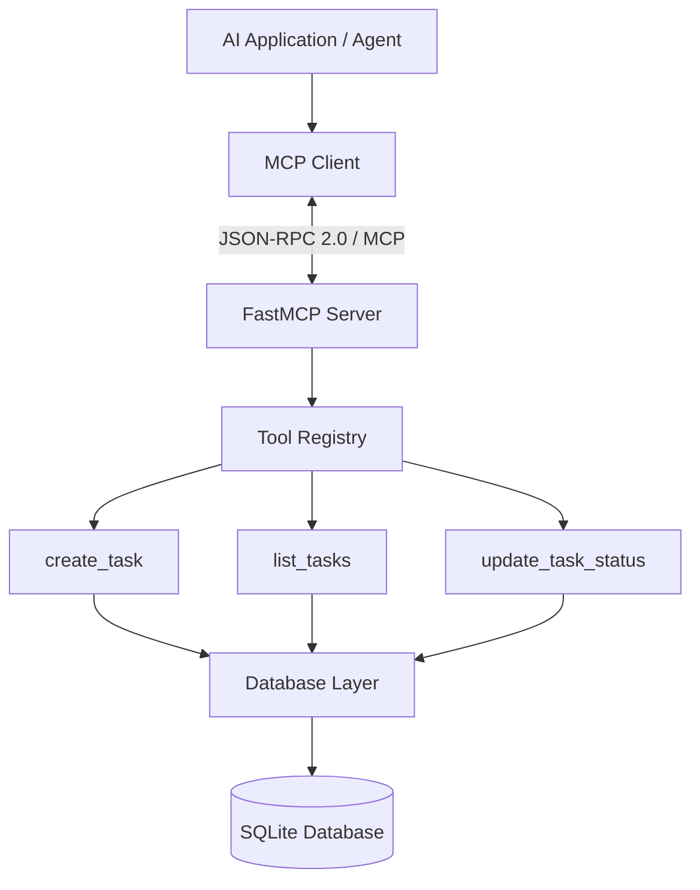

# ⚡ TaskFlow MCP

### Give your AI agents the power to manage real tasks.

\<p align="center">   \<strong>A Model Context Protocol (MCP) server for intelligent task management, powered by FastMCP, Python, and SQLite.\</strong> \</p>

\<p align="center">   ![Python]\([https://img.shields.io/badge/Python-3.12+-3776AB?style=for-the-badge&logo=python&logoColor=white](https://img.shields.io/badge/Python-3.12+-3776AB?style=for-the-badge\&logo=python\&logoColor=white))   ![MCP]\([https://img.shields.io/badge/Protocol-MCP-8A2BE2?style=for-the-badge](https://img.shields.io/badge/Protocol-MCP-8A2BE2?style=for-the-badge))   ![FastMCP]\([https://img.shields.io/badge/FastMCP-4.x-black?style=for-the-badge](https://img.shields.io/badge/FastMCP-4.x-black?style=for-the-badge))   ![SQLite]\([https://img.shields.io/badge/Database-SQLite-003B57?style=for-the-badge&logo=sqlite&logoColor=white](https://img.shields.io/badge/Database-SQLite-003B57?style=for-the-badge\&logo=sqlite\&logoColor=white)) \</p>

---

## ◈ What is TaskFlow MCP?

AI agents are great at reasoning. But reasoning alone doesn't get work done.

**TaskFlow MCP bridges that gap.**

TaskFlow MCP is an MCP server that exposes task-management capabilities to AI applications through a standardized interface.

Instead of manually interacting with a task database, an AI client can discover available tools, create tasks, retrieve task information, and update task statuses through MCP.

The result?

Your AI application doesn't just talk about getting things done. It can actually do them.

## ✨ Features

- **MCP-native architecture** — Communicate with AI applications using Model Context Protocol.
- **Dynamic tool discovery** — Clients can discover available tools through MCP.
- **Task creation** — Create tasks with titles, descriptions, and priorities.
- **Task retrieval** — Retrieve existing tasks from persistent storage.
- **Status management** — Update task statuses through tool invocations.
- **Persistent storage** — SQLite-backed task storage.
- **Asynchronous client** — Interact with the MCP server using Python's asyncio.
- **HTTP transport** — Connect to the server over Streamable HTTP.

## 🏗️ Architecture



### How it works

1. An AI application connects to the MCP server through an MCP client.
2. The client discovers available tools.
3. The AI application selects an appropriate tool.
4. The MCP client sends the tool invocation to the server.
5. FastMCP executes the corresponding Python function.
6. The database layer performs the requested operation.
7. The result is returned to the client.

## 🛠️ Available MCP Tools

| Tool                 | Description                            |
| -------------------- | -------------------------------------- |
| `create_task`        | Creates a new task                     |
| `list_tasks`         | Retrieves stored tasks                 |
| `update_task_status` | Updates the status of an existing task |

### Example: Create a task

```json
{
  "title": "Build an MCP server",
  "priority": "high",
  "description": "Implement task management using FastMCP"
}
```

The server generates a unique task ID and persists the task in SQLite.

### Example: Update task status

```json
{
  "task_id": "YOUR_TASK_ID",
  "status": "in progress"
}
```

## 🧰 Tech Stack

| Technology   | Purpose                                 |
| ------------ | --------------------------------------- |
| Python 3.12+ | Core implementation                     |
| FastMCP      | MCP server and client                   |
| SQLite       | Persistent storage                      |
| asyncio      | Asynchronous execution                  |
| uv           | Dependency and project management       |
| LangChain    | AI application integration dependencies |

## 📂 Project Structure

```text
MCP_server/
│
├── src/
│   └── mcp_server/
│       ├── __init__.py
│       ├── server.py
│       ├── client.py
│       └── database.py
│
├── data/
│   └── tasks.db
│
├── .env.example
├── .gitignore
├── .python-version
├── pyproject.toml
├── uv.lock
└── README.md
```

### Core modules

- **`server.py`** — Initializes the FastMCP server and registers task-management tools.
- **`client.py`** — Connects to the MCP server, discovers tools, and invokes them asynchronously.
- **`database.py`** — Handles SQLite initialization, task persistence, retrieval, and status updates.
- **`data/`** — Stores the local SQLite database.

## 🚀 Getting Started

### Prerequisites

- Python 3.12+
- [uv](https://docs.astral.sh/uv/)

### 1. Clone the repository

```bash
git clone https://github.com/Aniket-Mani/MCP_server.git

cd MCP_server
```

### 2. Install dependencies

```bash
uv sync
```

### 3. Start the MCP server

```bash
uv run python -m mcp_server.server
```

The server runs using HTTP transport:

```text
http://127.0.0.1:8000/mcp
```

### 4. Connect the MCP client

Open another terminal in the project directory:

```bash
uv run python -m mcp_server.client
```

The client connects to the running server, discovers available tools, and executes task-management operations.

## 🔌 Connecting an MCP Inspector

You can inspect and test the server using the official MCP Inspector.

Start the inspector:

```bash
npx @modelcontextprotocol/inspector
```

Configure the connection:

| Setting   | Value                       |
| --------- | --------------------------- |
| Transport | Streamable HTTP             |
| URL       | `http://127.0.0.1:8000/mcp` |

Connect and explore the available tools.

## 🧠 Understanding the MCP Integration

TaskFlow MCP demonstrates three fundamental concepts:

**1. Tool discovery**

The client requests the server's available tools through `tools/list`.

**2. Tool execution**

The client invokes a tool through `tools/call`, passing structured arguments.

**3. Persistent execution**

The server executes the underlying Python function and interacts with SQLite to persist changes.

MCP provides the standardized communication layer between the AI application and the capabilities exposed by the server.

## 🗺️ Roadmap

Potential future improvements:

- [ ] Task deletion
- [ ] Task filtering by priority and status
- [ ] Task deadlines and scheduling
- [ ] Search tasks by keyword
- [ ] MCP Resources for exposing task data
- [ ] MCP Prompts for reusable task workflows
- [ ] PostgreSQL support
- [ ] Authentication and authorization
- [ ] Automated testing and CI/CD
- [ ] Integration with an LLM-powered task-planning agent

## 🤝 Contributing

Contributions, suggestions, and improvements are welcome.

1. Fork the repository.
2. Create a feature branch.
3. Implement your changes.
4. Submit a pull request.

## 📜 License

Add your chosen open-source license here.

---

\<p align="center">
&#x20; \<strong>Built with Python. Powered by MCP. Designed for AI agents.\</strong>
&#x20; \<br/>
&#x20; \<sub>TaskFlow MCP — Turning AI capabilities into actionable workflows.\</sub>
\</p>
